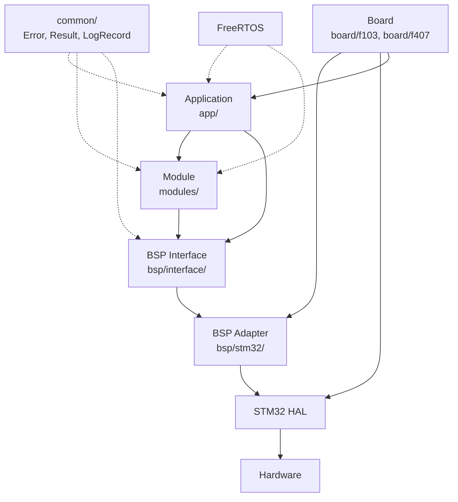

# 框架设计

## 1. 分层



题目要求的三层是 **Application / Module / BSP**。工程把 BSP 再拆成三小层：

| 层 | 目录 | 职责 | 允许依赖 |
|---|---|---|---|
| Application | `app/` | 任务编排、入口、测试 APP | Module、BSP Interface、FreeRTOS |
| Module | `modules/` | 设备与算法（IMU、Servo、Logger、协议） | BSP Interface、common |
| BSP Interface | `bsp/interface/` | 纯虚接口与配置结构体 | common |
| BSP Adapter | `bsp/stm32/` | HAL 适配，把 HAL 状态映射成 `common::Error` | BSP Interface、HAL |
| Board | `board/f103`、`board/f407` | 时钟、引脚、NVIC、句柄、链接脚本、中断向量 | HAL、BSP Adapter |
| Hardware | 芯片/模块 | — | — |

**铁律**：

- `app/`、`modules/`、`bsp/interface/` 不 include HAL 头。
- `bsp/stm32/` 是唯一允许出现 `stm32f1xx_hal.h` / `stm32f4xx_hal.h` 的 BSP 层。
- `board/` 负责“这块板子怎么接”，不实现业务。
- 业务只通过 `IUart`、`ICan`、`II2c`、`IPwm` 这些接口拿能力。

## 2. 依赖方向

```text
app  --->  modules  --->  bsp/interface
 |                           ^
 |                           |
 +---->  bsp/interface       |
                             |
board  --->  bsp/stm32  -----+--->  HAL
```

`bsp/interface` 不反向依赖 `bsp/stm32`；`board` 把具体 adapter 注入给 app，app 只看见接口引用。

例如串口：

```text
app/main.cpp
  -> board_uart()            // board 注入
  -> bsp::IUart&
  -> bsp::HalUart::write()
  -> HAL_UART_Transmit()
  -> USART1 寄存器
```

## 3. 目录说明

```text
app/
  main.cpp              裸机 LED + UART
  system_task.cpp       六任务系统入口
  imu_source.*          1 kHz IMU 生产者
  control_loop.*        500 Hz 控制
  comm_task.*           串口帧解析
  safety_task.*         超时监控
  telemetry_task.*      20 Hz 遥测
  *_test.cpp            各外设/功能验证入口

modules/
  imu/mpu6050.*         MPU6050/6500/9250
  servo/servo.*         舵机角度映射
  logger/logger.*       异步日志
  protocol/frame_parser.*  AA55 帧 + CRC8

bsp/interface/
  uart/uart.h           IUart、UartConfig、UartMode
  can/can.h             ICan、CanFrame、CanConfig
  i2c/i2c.h             II2c、I2cConfig
  pwm/pwm.h             IPwm、PwmConfig
  timer/gpio/           预留

bsp/stm32/
  uart/hal_uart.*       HAL UART 适配
  can/hal_can.*         HAL CAN 适配（F1）
  i2c/hal_i2c.*         HAL I2C 适配
  pwm/hal_pwm.*         HAL PWM 适配

board/f103/
  board.cpp             时钟、GPIO、USART1、TIM2/TIM3、I2C1、CAN1
  stm32f1xx_it.cpp      中断向量
  linker.ld             F103C8T6 链接脚本

board/f407/
  board.cpp             168 MHz、USART1、TIM2
  stm32f4xx_it.cpp      F407 中断向量
  linker.ld             512 KB Flash / 128 KB RAM

common/
  error/error.h         Error 枚举
  error/result.h        Result<T>（当前未使用，待清理）
  log/log.h             LogRecord、LogLevel
  time/                 预留
```

## 4. CMake target

| target | 内容 | 依赖 |
|---|---|---|
| `common` | `error.cpp`、`log.cpp` | 无 |
| `bsp_interface` | 头文件接口库 | `common` |
| `bsp_stm32` | HAL 适配源 | `bsp_interface`、HAL |
| `modules` | IMU、Servo、Logger、协议 | `common`、`bsp_interface`、FreeRTOS |
| `freertos` | FreeRTOS 内核 + heap_4 + ARM_CM3 port | 无 |
| `stm32f1_hal` / `stm32f4_hal` | HAL + CMSIS | 无 |
| `firmware` | app + board + 启动文件 + 链接脚本 | 以上按 `APP`/`BOARD` 选择 |

`BOARD=f103|f407` 决定 CPU flags、HAL target、board 源文件；`APP=...` 决定 app 入口。测试 APP 与产品 APP 目前都在 `app/` 根目录，后续应移到 `app/tests/`。

## 5. 启动流程

```text
Reset_Handler
  -> SystemInit
  -> __libc_init_array
  -> main
       -> BOARD_INIT()
            -> HAL_Init
            -> SystemClock_Config
            -> GPIO / USART1 / TIM2 / TIM3 / I2C1 / CAN1
            -> g_uart.init(115200, Blocking)
       -> app 初始化（logger、队列、任务）
       -> vTaskStartScheduler
```

`BOARD_INIT()` 失败会调用 `fatal_error(error, file, line)`，把错误码/文件/行号写到：

```text
g_fatal_error_code
g_fatal_file
g_fatal_line
```

然后关中断停住；Ozone/J-Link 可直接读这三个全局变量。

## 6. 错误处理

- 外设接口返回 `common::Error`，不用 bool + 全局 errno。
- HAL 状态在 adapter 中映射：`HAL_OK→Ok`、`HAL_BUSY→Busy`、`HAL_TIMEOUT→Timeout`、其余→`Hardware`。
- 初始化失败返回第一个错误，不再在 `board_init()` 里直接死循环。
- 运行期错误（CRC、队列满、总线忙）由调用者决定计数/重试/停机。
- `Result<T>` 目前是未使用代码，保留是为了以后需要返回值 + 错误码的 API；当前实际用 `Error` + 出参。

## 7. 扩展一个新外设

以 `foo` 为例：

1. `bsp/interface/foo/foo.h`：配置结构体、`IFoo` 纯虚接口、回调类型。
2. `bsp/stm32/foo/hal_foo.{h,cpp}`：实现 `IFoo`，只在这里 include HAL。
3. `board/f103`：加句柄、时钟/引脚/NVIC 初始化，提供 `board_foo()` 注入。
4. `modules/`：如果需要设备语义，包一层 `Foo` 模块。
5. `app/`：用 `board_foo()` 或模块，不直接碰 HAL。
6. `CMakeLists.txt`：把新源文件加入对应 target。
7. `docs/interfaces/foo.md` + `docs/testing/foo.md`。
8. 跑 `tools/check_layering.ps1`。

## 8. 设计取舍

- **接口用纯虚类，不用模板接口**：二进制边界清楚，adapter 可替换；代价是虚调用开销，当前外设访问频率下可接受。
- **Board 注入，不在 app 里 new**：避免动态分配，也避免 app 知道具体芯片。
- **错误码统一**：调用者能区分超时/忙/硬件/校验错；代价是每个调用点都要检查。
- **FreeRTOS 队列/事件组代替观察者模式**：本质也是发布订阅，少一层类继承；文档里说明对应关系即可。
- **不追求“大而全”**：UART 只做阻塞 + 中断，CAN 只做 Loopback，F407 只做最小移植；先把边界和测试做扎实。

## 9. 当前完成度

- 完成：分层、CMake target、`check_layering`、Error、UART、CAN Loopback、I2C+MPU6500、PWM、FreeRTOS 六任务、F407 UART+TIM2、命令帧+CRC。
- 部分完成：SG90 实际转动未通过；CAN 外部总线未测；F407 只移植 UART+TIM2。
- 未完成：单元测试、HIL、UART DMA、PA7 第二路 PWM、接口膨胀清理、最终视频/tag。
